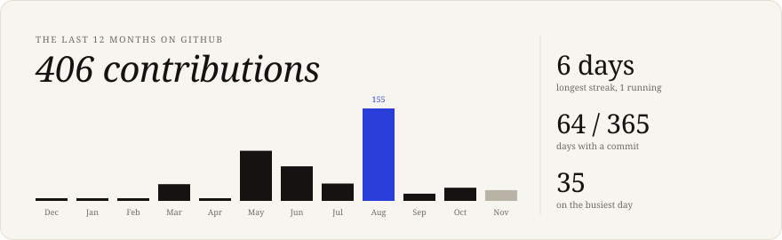
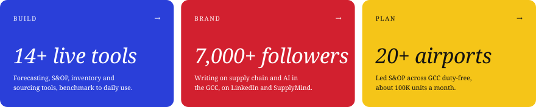
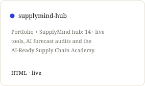
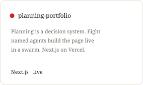
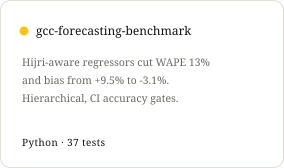
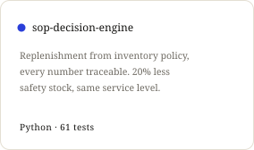
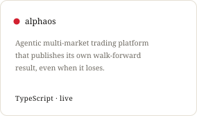
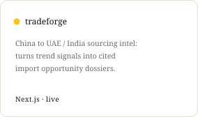

### Also live

- **[AI Forecast Audits](https://vinayakbhadani.com/hire.html)** · independent out-of-sample check: does your AI forecast beat a seasonal naive baseline?
- **[AI-Ready Supply Chain Academy](https://vinayakbhadani.com/academy/)** · planning, S&OP, PSI and ERP master data training for working professionals
- **[Supply Planning Workbench](https://african-eastern-supply-planner.vercel.app/)** · S&OP supply planning and purchase order recommendation cockpit
- **[P2P Desk](https://p2p-desk-demo.vercel.app/)** · procure-to-pay operations demo on dummy data
- **[Trade-show sourcing app](https://beautyworld-2026.vercel.app/)** · scan supplier QR codes, log samples with photos, export per supplier
- **[S&OP Copilot](https://sop-copilot.vercel.app/)** and **[Event Surge Planner](https://event-surge-planner.vercel.app/)** · Monday S&OP brief and Ramadan / Eid / DSF demand surges for GCC brands
- **Stock Register app** · iPad inventory system in daily use by 50-70 retail staff (internal, not public)

### Recently pushed
<!-- RECENT_REPOS:START -->
<!-- This section auto-updates daily via GitHub Actions -->
- **[vinayakbhadani.github.io](https://github.com/Vinayak682/vinayakbhadani.github.io)** · Portfolio site · Demand Planning Analyst & AI Supply Chain Builder based in Dubai, UAE _(updated 2026-11-09)_
- **[confeitaria-by-minty](https://github.com/Vinayak682/confeitaria-by-minty)** · Confeitaria by Minty · boutique bakery web experience. JavaScript. _(updated 2026-11-06)_
- **[alphaos](https://github.com/Vinayak682/alphaos)** · Agentic multi-market trading platform whose walk-forward test says its own strategies don't beat buy-and-hold. Multi-agent research, AI signals, client-side backtesting. Next.js 16 + Supabase + Groq. _(updated 2026-11-01)_
- **[bizops-crash-course](https://github.com/Vinayak682/bizops-crash-course)** · Beginner crash course for a Biz Ops demand planning interview: concepts, calculators, flashcards, quiz, 2-day plan _(updated 2026-10-21)_
- **[Interview-Prep](https://github.com/Vinayak682/Interview-Prep)** · Interview Preparation  _(updated 2026-10-14)_
- **[Vinayak682.github.io](https://github.com/Vinayak682/Vinayak682.github.io)** · Vinayak Bhadani – Demand Planning Analyst | Dubai, UAE _(updated 2026-09-26)_
<!-- RECENT_REPOS:END -->

<a href="https://vinayakbhadani.com/">vinayakbhadani.com</a> &nbsp;/&nbsp;
<a href="https://www.linkedin.com/in/vinayakbhadani/">linkedin</a> &nbsp;/&nbsp;
<a href="https://www.instagram.com/nextgensupplychain.ai">instagram</a> &nbsp;/&nbsp;
<a href="https://vinayakbhadani.com/Vinayak-Bhadani-Resume-Demand-Planning-AI-Supply-Chain.pdf">resume</a> &nbsp;/&nbsp;
<a href="mailto:vinayakbhadani1998@gmail.com">email</a>

